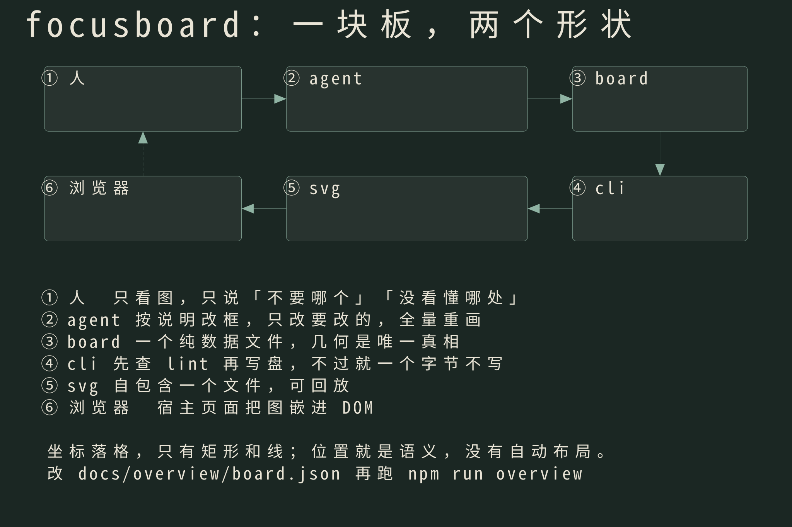

# focusboard

**把讨论变成一块板。**

和 agent 讨论方案时，让它把话画出来：一块板上只有扁平的矩形和线，agent 持续维护，人只负责看和说。



> 这张图是 focusboard 自己画的：源是 [`docs/overview/board.json`](docs/overview/board.json)，`npm run overview` 重新生成。它没有排版引擎，每一格、每一条线都在 JSON 里写明。

## 它解决什么

现成的三种都在解决别的问题：

- **Mermaid / PlantUML** 是编译：你给源码，它算布局。同一个结构，位置由算法决定，你说不出「这个放左下角，因为它是被否决的方案」。而在板书里，位置本身就是语义。
- **Excalidraw / 白板** 是给人手画的：agent 画得慢、画得丑，而且控制不住位置。
- **聊天里贴图** 每轮都是从零开始，人无法确认「改了哪一处」—— 因为没有「同一块板」这个概念。

缺的是第四种：一个 agent 能持续往上面写、人只负责看和说的地方。这个仓库就是那个地方。

一块板 = 一个对页面的坐标 + 两个形状。几何是唯一真相，所以它可 diff、可回放、可自查：`check` 能告诉你每框还剩几列、哪里折行、谁压住了谁。

## 快速开始（用）

对外发布的东西是**一个 skill 包**，不是一个 npm 包。从 [Releases](https://github.com/fqmoon/focusboard/releases) 下载 `focusboard-skill-<版本>.tar.gz`，解压后是这样：

```
focusboard-skill/
  README.md            # 这份说明的人读版
  SKILL.md             # 给 agent 的说明：三步、写板规则、判断
  focusboard.mjs       # 单文件 CLI，零依赖，node 20+
  board.example.json   # 最小板，复制它开始改
  LICENSE              # MIT
```

它自包含：不依赖 `node_modules`、不依赖本仓库、不需要联网。

```bash
cp board.example.json board.json                        # 1. 写板
./focusboard.mjs check board.json --text                # 2. 自查，画之前就该跑
./focusboard.mjs submit board.json --out out --page     # 3. 交付 out/board.svg + out/index.html
```

给 agent 用的话，把整个目录放进它的 skills 目录，或者只把 `SKILL.md` 的内容当提示词 —— agent 读完就知道怎么画、怎么自查、什么时候该开新板。

## 快速开始（改）

```bash
git clone https://github.com/fqmoon/focusboard && cd focusboard
npm install
npm test             # 编译并跑 core / svg-render / cli 的测试（65 个）
npm run example      # 用 examples/host/board.json 出一张板 → examples/host/out/
npm run overview     # 重画 README 里那张自述图 → docs/overview/board.svg
npm run build:skill  # 打包产物 → dist/focusboard-skill-<版本>.tar.gz
```

打开 `examples/host/out/index.html` 能看到示例板（`board.json` 是运行流程图，`arch.json` 是架构图）。

## 仓库结构

```
packages/core/        规则库：schema、校验、几何查询、lint、字格与档位。纯计算，不碰 DOM。
packages/svg-render/  渲染器：toSVG(board) → 字符串。依赖 core，不碰 DOM。
packages/cli/         focusboard check / submit。argv、fs、退出码只在这里。
skill/                产物的源：SKILL.md、human README、示例板。
scripts/build-skill.mjs  打包：单文件 bundle + 说明 + 许可 → tarball。
docs/                 设计记录：产品、路线、技术。
```

`packages/*` 是 workspace，**不发布到 npm**，只在本仓库内解析。对外只有一个东西：Release 里的 skill 包。

## 命令：查与交

两个动词，区别只在写不写盘：

```bash
focusboard check  [file] [--text] [--free x,y,w,h] [--hit x,y]   # 只读，不写盘
focusboard submit [file] [--out dir] [--page] [--text]           # 提交，写 SVG
```

- `file` 省略或写 `-` 就从 stdin 读整块板。
- **默认输出 JSON**（给机器读），`--text` 切人读。日志走 stderr，stdout 只有结果。
- `submit` 先 `lint`：**errors 非空就一个字节都不写**，上一版文件留着 —— 画坏一次不会毁掉当前板。
- 退出码：`0` 无 error / `1` lint 有 error / `2` 用法错。
- 元素 schema 只有一份，在 `core` 里；CLI 不重新定义任何形状。

```bash
$ focusboard submit board.json --out out
{ "errors": [], "warnings": [], "rendered": true, "wrote": [".../out/board.svg"] }
```

`check --text` 打的是同一份数据的文字版：每框 `capacity N 列 × M 行`、每行占几列、有没有被自动折行、哪些汉字偏半格。

查询也吃整块板：它问的是「你手里这一版」，所以提交之前就能问；宿主持有「上一版」会引入版本歧义。

## 作为库使用

```js
import { lint } from '@focusboard/core';
import { toSVG } from '@focusboard/svg-render';

const board = { tier: 'medium', elements: [/* ... */] };

const { errors, warnings } = lint(board);
if (errors.length === 0) element.innerHTML = toSVG(board);
```

传输、页面更新、持久化都由调用方决定：HTTP、SSE、文件、postMessage 都行。这个仓库是 SDK，不是服务。

## 边界

- **lint 只查七件事**：重复 id、悬空线、越界、框与框部分重叠、线穿过某个框、文字溢出、文字过多（有边框的框写到三行就报 `text_dense`）。**不查线与线交叉**，也不查「间距难不难看」—— 图和你想的不一样，是常态，`submit` 之后看一眼。
- **没有自动布局、没有父子层级、没有无限画布。** 位置由生成方给，好不好看由人判断。框可以包住框，但那是几何：严格包含不报 `partial_overlap`，容器里的连线也不算穿过；没有 `parent`，数组顺序就是 z 序，容器要写在子框前面。
- **不做**：npm 发布、常驻服务、watch、HTTP 端点、增量更新。
- 版本 `0.2.3`，路线见 [`docs/roadmap.md`](docs/roadmap.md)。

## 文档

- [`docs/product.md`](docs/product.md)：这是什么、为什么做、和 Mermaid / SVG 的区别
- [`docs/tech.md`](docs/tech.md)：为什么是浏览器、SDK 为什么这么切、全量重画意味着什么
- [`docs/roadmap.md`](docs/roadmap.md)：走到哪了、下一步、已知风险

## License

MIT © 2026 [fqmoon](https://github.com/fqmoon)
